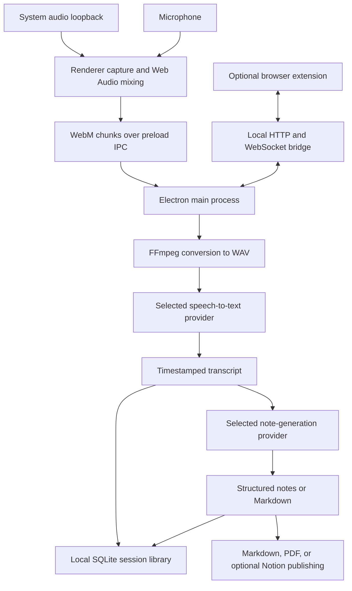

# NovaMeet

**AI-powered meeting recording, transcription, and structured notes for the desktop.**

NovaMeet is an open-source desktop application built with Electron and React. It captures system audio and microphone input, turns recordings into timestamped transcripts, and generates meeting summaries, decisions, and action items using your preferred AI providers. Meetings remain accessible in a local library, with optional Notion publishing, Google Calendar integration, and Markdown and PDF output.

## Contents

- [Capabilities](#capabilities)
- [Platform support](#platform-support)
- [Architecture](#architecture)
- [System audio and microphone capture](#system-audio-and-microphone-capture)
- [AI providers and model configuration](#ai-providers-and-model-configuration)
- [Developer setup](#developer-setup)
- [Integrations](#integrations)
- [Development commands and validation](#development-commands-and-validation)
- [Build and packaging](#build-and-packaging)
- [Local data and credentials](#local-data-and-credentials)
- [Troubleshooting](#troubleshooting)
- [Contributing](#contributing)
- [Further documentation](#further-documentation)
- [License](#license)

## Capabilities

| Area | What NovaMeet provides |
| --- | --- |
| Recording | System audio and microphone capture, live input meters, and local audio playback with a waveform. |
| Transcription | Google Cloud Speech-to-Text, Sarvam AI, AssemblyAI, and Groq Whisper, with timestamped segments and speaker labels where supported. |
| Meeting notes | Google Gemini, Groq, or Anthropic Claude; structured JSON or Markdown output; editable system prompts; an optional fallback provider and model. |
| Meeting library | Local session history, search, filters, transcript review, and editable notes. |
| Existing material | Import audio or video for processing, or paste a transcript to generate notes without recording. |
| Desktop assistance | Windows meeting detection, a floating recording overlay, and tray controls. |
| Integrations | Optional Notion publishing, upcoming Google Calendar meetings, and a Chromium browser extension for Google Meet and Zoom. |
| Sharing | Copy notes as Markdown or export a PDF, optionally including the transcript. |

Transcription and note generation run after recording or import; the audio meters provide live capture feedback. Cloud AI processing requires credentials for the selected providers.

## Platform support

| Platform | Support and requirements |
| --- | --- |
| Windows x64 | NSIS installer and unpacked build targets. Primary system audio capture uses WASAPI loopback through Electron; direct FFmpeg capture is available as a fallback. Native meeting detection is Windows-only. |
| macOS Apple Silicon and Intel | Beta support on macOS 14.2 or later. System audio capture uses Electron's Core Audio tap integration. Microphone and Screen & System Audio Recording permissions are required for full capture. DMG and ZIP targets are configured for both architectures. |
| Linux | No packaged build target or documented system audio capture path is configured. |

The current macOS packaging configuration uses ad-hoc signing and is not notarized. macOS may require approval to open the application and renewed recording permissions after an update. The macOS updater directs users to download a new release rather than installing it in place.

## Architecture

NovaMeet runs as a local Electron application. The main process manages operating system access, persistence, processing, and integrations; the renderer presents the interface and performs the primary audio capture. Cloud requests are delegated to provider modules in the main process.



### Process and service responsibilities

| Component | Responsibility |
| --- | --- |
| Electron main process | `electron/main.js` coordinates windows, tray actions, recording state, IPC handlers, session processing, and integrations. |
| Preload bridge | `electron/preload.js` exposes the `window.novameet` API for settings, sessions, capture events, exports, and integrations. Context isolation is enabled and renderer Node.js integration is disabled. |
| React renderer | `renderer/app.jsx` and `renderer/components/` implement the dashboard, meeting library, note and transcript viewers, settings, and capture controls. Vite builds the main and overlay entry points. |
| Audio services | `electron/audio/` handles FFmpeg resolution, conversion, Windows device enumeration and fallback recording, waveform extraction, and macOS capture strategy definitions. |
| Provider registry | `electron/providers/` defines separate speech-to-text and language-model registries. Provider descriptors supply credentials, models, capabilities, and connection tests to Settings. |
| Processing services | `electron/services/transcription.js` validates audio and dispatches transcription. `electron/services/notes.js` resolves prompts, generates notes, parses responses, and applies an optional fallback. |
| Persistence | `electron/db/sessions.js` uses `sql.js` to maintain a SQLite session database on disk. `electron/utils/config.js` stores preferences and provider credentials with `electron-store`. |
| Detection and overlays | `electron/detection/` reads Windows microphone activity and window titles; `electron/overlay/` manages the native floating window. Detection does not require the browser extension. |
| Optional integrations | Notion, Google Calendar, PDF export, and update services live in `electron/services/`. The extension communicates through `electron/websocket-server.js`. |

### Processing lifecycle

1. Start a recording, import a media file, or paste a transcript.
2. For recorded or imported media, create a 16 kHz, mono, 16-bit PCM WAV file using FFmpeg.
3. Check the recording for silence, then send it to the selected speech-to-text provider. Each adapter handles its own upload, chunking, polling, and transcript normalization.
4. Pass the resulting transcript to the selected language model with the configured output mode and system prompt. Pasted transcripts enter the pipeline at this stage.
5. Save the transcript and notes in the local session library. Notes can then be reviewed, edited, exported, or published to Notion when configured.

Speech-to-text adapters return segments shaped as `{ speaker, text, startTime, endTime }`. Language-model adapters return text that the notes service parses into structured notes or Markdown. This keeps provider-specific API behavior separate from the interface and session workflow.

### Repository layout

```text
electron/
  main.js                 Application lifecycle and IPC orchestration
  preload.js              Renderer-facing desktop API
  audio/                  Capture, mixing, conversion, and FFmpeg lookup
  db/                     Local session persistence
  detection/              Windows meeting detection
  overlay/                Native floating window
  providers/              Speech-to-text and language-model adapters
  services/               Processing, integrations, exports, and updates
  utils/                  Configuration and logging
renderer/
  components/             Meeting views, settings, and shared interface elements
  lib/                    State, search, formatting, and audio helpers
  styles/                 Application and overlay styles
extension/                Chromium extension source
assets/                   Icons, packaging resources, and local FFmpeg binaries
scripts/                  Asset generation, binary downloads, and packaging helpers
tests/                    Vitest tests
docs/                     Detailed architecture and integration guides
```

## System audio and microphone capture

System audio loopback captures sound playing through the computer's audio output, including remote participants in a call. The microphone captures local speech. NovaMeet combines these inputs so a recording can include both sides of a meeting.

Loopback is an output capture mechanism, so unrelated application sounds can also enter the recording. Use headphones to reduce acoustic echo and play a short test clip before an important meeting.

### Primary capture pipeline

The renderer requests system audio with `navigator.mediaDevices.getDisplayMedia()` and microphone input with `getUserMedia()`. Electron's display-media request handler supplies a loopback audio stream. Although the display-media request includes video, NovaMeet stops the video track immediately and records audio only.

An `AudioContext` mixes the available audio inputs into a `MediaStreamDestination`. `MediaRecorder` encodes the result as WebM, using Opus when available, and emits chunks approximately once per second. The preload bridge forwards those chunks to the main process, which appends them to a local file. On stop, FFmpeg converts the recording to the WAV format used by the transcription pipeline.

System and microphone meters monitor the inputs independently. A missing microphone can leave a system-audio-only recording; a missing system stream on macOS can leave a microphone-only recording with a warning. A visible recording timer alone does not confirm that both inputs contain sound.

### Windows: WASAPI loopback

The preferred Windows path uses Chromium's **Windows Audio Session API (WASAPI)** loopback through Electron. It captures playback from the default output device, including speakers and wired, USB, or Bluetooth headphones, without requiring Stereo Mix or a virtual audio cable.

If renderer capture cannot start, NovaMeet attempts direct FFmpeg recording:

1. Use the configured system audio and microphone devices, preferring WASAPI loopback for system audio.
2. If FFmpeg reports an unsupported loopback option, attempt a detected DirectShow loopback source such as Stereo Mix or a virtual cable output.
3. If no compatible DirectShow loopback source is available but a microphone is configured, record the microphone alone.

This fallback depends on the input devices and features available in the FFmpeg build. Stereo Mix can be tied to a particular sound card and may remain silent when playback uses another output. It is unnecessary for the primary Electron loopback path.

Before recording, confirm that the meeting application is playing through the intended default output and that Windows permits desktop applications to access the microphone. If headphones or output devices change, run another short recording and check both meters and playback.

### macOS: Core Audio taps and permissions

On macOS 14.2 and later, Electron's loopback integration uses the **Core Audio tap API** to capture system playback. The application includes microphone and audio-capture usage descriptions in its packaging configuration.

Open **System Settings > Privacy & Security** and allow NovaMeet to use:

- **Microphone**, for local speech.
- **Screen & System Audio Recording**, for system playback capture. The permission name can vary with macOS version.

Under **Settings > System > Test system audio**, play a video or music and test the available capture strategies:

| Strategy | Behavior |
| --- | --- |
| `screen` | Default. Supplies a screen from Electron's desktop capturer as the display-media video source, alongside loopback audio. |
| `frame` | Supplies NovaMeet's own window frame where available. This is an alternative to test on the target Mac; it is not a guarantee that screen recording permission can be avoided. |
| `picker` | Requests the macOS system picker when available; otherwise Electron uses the registered display-media handler. |

Select the strategy that detects actual audio on the target machine. These tests make short captures, so system playback must be active while testing. The strategy is stored as `macCaptureStrategy`.

macOS has no direct FFmpeg system-audio fallback in this application. If system capture is unavailable, the renderer may record only the microphone; if neither source is available or capture fails completely, recording fails with permission guidance. After installing an update, revisit permissions and test again if capture becomes silent.

## AI providers and model configuration

NovaMeet configures speech recognition and note generation independently. For example, a meeting can use AssemblyAI for transcription and Gemini for notes, or Groq for both stages. Only the providers you select need credentials, except when an additional note-generation fallback is enabled.

The following models are declared in this checkout's provider registry. Their presence in Settings does not guarantee access for a particular provider account; use the connection test to check your credentials and selected model.

### Speech-to-text providers

Configure these under **Settings > Transcription**.

| Provider | Default model | Other configured models | Credential setting | Notes |
| --- | --- | --- | --- | --- |
| Google Cloud STT | `chirp_3` | `latest_long` | `googleApiKey` | API version and effective model depend on the project and storage configuration described below. Speaker labeling depends on the selected API path. |
| Sarvam AI | `saaras:v3` | Custom model IDs supported | `sarvamApiKey` | Job-based processing with speaker diarization; intended to support multilingual and mixed-language meetings. |
| AssemblyAI | `universal-3-pro` | `universal-2` | `assemblyAiApiKey` | Upload-and-poll workflow with speaker diarization and optional transcription guidance through `assemblyAiPrompt`. |
| Groq Whisper | `whisper-large-v3-turbo` | `whisper-large-v3`; custom model IDs supported | `groqApiKey` | Chunked uploads and segment timestamps. No speaker diarization; segments are labeled `Speaker 1`. |

The initial speech-to-text provider is Google Cloud STT. Transcription dispatches to the selected provider; the language-model fallback described below does not switch speech-to-text providers.

#### Google Cloud transcription modes

The Google adapter chooses its path from the model and optional project settings:

| Configuration | Selected path |
| --- | --- |
| No Google Cloud project ID, or model set to `latest_long` | Speech-to-Text v1 using `latest_long`, with an API key and chunking for longer audio. |
| Project ID set, non-`latest_long` model, no storage bucket | Speech-to-Text v2 synchronous recognition, split into chunks for longer recordings. The current implementation sends the configured API key on this path. |
| Project ID and bucket set, non-`latest_long` model | Speech-to-Text v2 BatchRecognize after uploading the WAV to Google Cloud Storage. Uses a service account access token and attempts to delete the temporary object afterward. |

For BatchRecognize, configure `googleCloudProjectId`, `googleCloudStorageBucket`, and an explicit JSON service account file path in `googleCloudStorageKeyPath`. The bucket field expects a name rather than a `gs://` URL. The current BatchRecognize implementation requires the explicit key-file setting; an ambient Google credentials environment variable alone does not satisfy that check.

The service account needs permission to upload and delete temporary audio objects, and the Speech-to-Text service needs access to read them. See the [GCS setup guide](docs/GCS-SETUP.md) for the bucket and service account workflow. Validate the selected mode with a short recording before processing a long meeting, especially when changing API versions or authentication settings.

### Note-generation providers

Configure these under **Settings > Notes**.

| Provider | Default model | Other configured models | Credential setting |
| --- | --- | --- | --- |
| Google Gemini | `gemini-3.8-flash` | `gemini-3.7-flash`, `gemini-3.5-flash-lite`, `gemini-3.1-pro-preview` | `geminiApiKey` |
| Groq | `llama-3.3-70b-versatile` | `openai/gpt-oss-120b`, `openai/gpt-oss-20b`, `llama-3.1-8b-instant` | `groqApiKey` |
| Anthropic Claude | `claude-sonnet-5-5` | `claude-fable-5-1`, `claude-opus-5-5`, `claude-haiku-5-5` | `claudeApiKey` |

All three note-generation adapters accept custom model IDs. Gemini is the initial note-generation provider. Groq speech recognition and note generation share the same `groqApiKey` setting.

Choose **JSON (structured)** for discrete summary, topics, decisions, and action-item fields, or **Markdown** for formatted meeting minutes. Each mode has a default system prompt. A custom system prompt takes precedence; reset it when switching formats if it still requests the previous format.

### Primary and fallback models

Each provider retains its selected model. An optional secondary provider/model can be enabled for note generation and is disabled by default. If the primary is missing credentials or generation or response parsing fails, the notes service attempts the distinct fallback target once. The fallback can be another model from the same provider or a model from another provider; it needs valid credentials of its own.

For example, the following configuration selects Groq Whisper for transcription, Gemini for notes, and Groq as the notes fallback:

```json
{
  "sttService": "groq",
  "sttModels": {
    "groq": "whisper-large-v3-turbo"
  },
  "llmProvider": "gemini",
  "llmModels": {
    "gemini": "gemini-3.8-flash"
  },
  "llmFallback": {
    "provider": "groq",
    "model": "llama-3.3-70b-versatile"
  },
  "noteOutputMode": "json"
}
```

This is a configuration reference, not a file to create in the repository. Set the equivalent choices in Settings and supply `groqApiKey` and `geminiApiKey` there. An empty `llmFallback` object disables fallback. Using a fallback can send the transcript to the secondary provider as well.

## Developer setup

### 1. Prepare the toolchain

- **Git** to clone the repository.
- **Node.js 24** as a development baseline, with npm available.
- **pnpm 12.3.4**, matching the `packageManager` field in `package.json`.
- **Windows x64 or macOS 14.2+** for the desktop capture flows described above.
- **FFmpeg and FFprobe**, fetched in step 3. They are required for media conversion and duration probing even when Electron handles capture.
- On macOS, the **`zip` command** for extension packaging and **Xcode Command Line Tools** for desktop packaging.

Install the pinned package manager if it is not already available:

```sh
npm install --global pnpm@12.3.4
node --version
pnpm --version
```

In Windows PowerShell, use `npm.cmd` and `pnpm.cmd` if script execution policy blocks the corresponding `.ps1` launchers.

### 2. Clone and install dependencies

Replace `<repository-url>` with the URL of your NovaMeet repository. The explicit destination keeps subsequent commands consistent:

```sh
git clone <repository-url> NovaMeet
cd NovaMeet
pnpm install --frozen-lockfile
```

The repository configures dependency build permissions and architecture handling in `pnpm-workspace.yaml`. Keep that file and the lockfile in place when installing dependencies. To download Electron explicitly before first launch, run:

```sh
pnpm exec install-electron
```

### 3. Fetch FFmpeg and FFprobe

```sh
pnpm run fetch-ffmpeg
```

The script downloads the pinned builds declared in `electron/audio/ffmpeg-sources.js` and verifies their SHA-256 checksums. On Windows it fetches x64 binaries; on macOS it fetches both supported architectures by default.

| Target | Development binary location |
| --- | --- |
| Windows x64 | `assets/ffmpeg/ffmpeg.exe` and `assets/ffmpeg/ffprobe.exe` |
| macOS Apple Silicon | `assets/ffmpeg/mac-arm64/ffmpeg` and `assets/ffmpeg/mac-arm64/ffprobe` |
| macOS Intel | `assets/ffmpeg/mac-x64/ffmpeg` and `assets/ffmpeg/mac-x64/ffprobe` |

For a single macOS architecture, use the script directly:

```sh
node scripts/fetch-ffmpeg.js --platform darwin --arch arm64
```

Runtime lookup also supports system-installed binaries on `PATH` and common Homebrew locations on macOS. **Settings > System** shows detected binaries and offers an in-app download. Packaging expects the platform-specific binaries in `assets/ffmpeg/`; a system installation alone does not populate those build resources.

### 4. Start the desktop application

```sh
pnpm run dev
```

The `predev` hook generates icons and packages the extension before starting Vite and Electron concurrently. Vite serves the renderer on port `5173`; Electron loads that development URL and supplies the desktop APIs. A standalone browser preview does not provide recording, local persistence, or integration IPC.

For separate renderer and Electron terminals, run `pnpm run generate-icons` and `pnpm run build:ext` once, then start `pnpm run dev:renderer` followed by `pnpm run dev:electron` in a second terminal after Vite is ready.

### 5. Configure and verify the first session

1. Open **Settings > System** and confirm FFmpeg and FFprobe are detected. On macOS, grant recording permissions and run **Test system audio**.
2. Open **Settings > Transcription**, choose a provider and model, enter its credentials, and use its connection test.
3. Open **Settings > Notes**, choose a provider and model, enter its credentials, and select the output format. Configure a fallback only if needed.
4. Save the settings. Play a short clip and speak into the microphone during a brief recording; confirm the input meters respond.
5. Stop recording, inspect the transcript and notes, and play back the audio to confirm both system sound and microphone input were captured.

Provider connection tests and processing contact external APIs and may consume provider quota. UI development, linting, and the mocked provider tests do not require personal API keys.

### Configuration files and environment variables

The desktop application reads runtime provider credentials from its persisted Settings configuration. **The current Electron code does not load `.env` or map the variables in `.env.example` into those settings.** Copying `.env.example` to `.env` does not configure transcription, note generation, or Notion.

Use `.env.example` as a reference for credential types and enter the actual values through Settings. For developers mapping that reference to the runtime configuration:

| Reference variable | Runtime setting |
| --- | --- |
| `GOOGLE_API_KEY` | `googleApiKey` |
| `GEMINI_API_KEY` | `geminiApiKey` |
| `GROQ_API_KEY` | `groqApiKey` |
| `CLAUDE_API_KEY` | `claudeApiKey` |
| `SARVAM_API_KEY` | `sarvamApiKey` |
| `NOTION_TOKEN` | `notionToken` |
| `NOTION_DATABASE_ID` | `notionDatabaseId` |

AssemblyAI is configured through `assemblyAiApiKey` in Settings even though the example environment file does not list it. Keep credentials and service account files out of commits and build resources.

## Integrations

### Notion

In **Settings > Integrations**, enter an integration token and a destination page or database ID, or its full Notion URL. Grant the integration access to that destination in Notion, test the connection, and save the settings. NovaMeet can publish generated notes to the configured destination, with an option to include the transcript. Local notes and exports remain available without Notion.

### Google Calendar

To display upcoming meetings, enable the Google Calendar API for your Google Cloud project, configure a Desktop app OAuth client, and enter its client ID and secret under **Settings > Integrations**. Use **Connect Google Calendar** to complete authorization in the browser. The application stores the resulting refresh token locally and provides a disconnect action.

### Browser extension

The optional Manifest V3 extension adds meeting context and controls to supported Google Meet and Zoom pages. Keep the desktop application running while using it.

For local development:

1. Open `chrome://extensions` or the equivalent extension page in your Chromium browser.
2. Enable **Developer mode**, choose **Load unpacked**, and select the repository's `extension/` directory.
3. Open a supported meeting page and check the extension's desktop connection.

`pnpm run build:ext` also creates `dist/novameet-extension.zip`. The desktop bridge binds to `127.0.0.1`, starting at port `39842` and trying through `39852` when ports are occupied. It is a local companion connection, not a hosted backend.

## Development commands and validation

| Command | Purpose |
| --- | --- |
| `pnpm run dev` | Generate assets, package the extension, and run Vite with Electron. |
| `pnpm run dev:renderer` | Run only the Vite development server. |
| `pnpm run dev:electron` | Run only Electron in development mode; expects Vite on port `5173`. |
| `pnpm run lint` | Run ESLint across the repository. |
| `pnpm test` | Run the Vitest suite once. |
| `pnpm run test:watch` | Run Vitest in watch mode. |
| `pnpm run build:renderer` | Build the renderer into `dist/renderer/`. |
| `pnpm run preview` | Preview the built renderer without Electron desktop APIs. |
| `pnpm run generate-icons` | Generate application icon assets. |
| `pnpm run build:ext` | Package the browser extension. |
| `pnpm run fetch-ffmpeg` | Download and verify the pinned media binaries. |

Before submitting code changes, run the relevant tests and lint checks:

```sh
pnpm run lint
pnpm test
pnpm run build:renderer
```

The test suite covers provider contracts and mocked requests, formatting and Markdown helpers, meeting search and detection rules, waveform utilities, FFmpeg resolution, and macOS capture strategy and permission UI logic. It does not establish that hardware capture, OS permissions, IPC workflows, or live provider integrations work end to end. Exercise affected desktop flows on the target operating system as well.

## Build and packaging

Fetch the required FFmpeg binaries before packaging. Generated renderer output goes to `dist/renderer/`; desktop artifacts go to `dist/desktop/`.

| Command | Result |
| --- | --- |
| `pnpm run build` | Build the renderer and Windows x64 NSIS installer. Runs icon and extension preparation and disables publishing. |
| `pnpm run build:dir` | Build the renderer and an unpacked Windows application directory. |
| `pnpm run build:mac` | Build macOS DMG and ZIP artifacts for Apple Silicon and Intel. Runs icon and extension preparation and disables publishing. |
| `pnpm run build:mac:dir` | Build the renderer and an unpacked macOS application directory. |

Use a Windows environment for the Windows packaging workflow and a macOS environment for macOS packaging. The unpacked commands do not have the same asset-generation hooks as `build` and `build:mac`; run `pnpm run generate-icons` and `pnpm run build:ext` first if those assets need refreshing.

The low-level `pnpm run build:electron` command packages existing renderer output using the Windows target. It does not rebuild the renderer or run the main build's preparation hook.

Platform targets, bundled resources, permissions, signing options, and artifact names are defined in [electron-builder.yml](electron-builder.yml). Packaging is separate from release publication; review signing and distribution configuration before distributing a build.

## Local data and credentials

NovaMeet uses Electron's application data directory, resolved at runtime by `app.getPath('userData')`, to store:

| Location within application data | Contents |
| --- | --- |
| `novameet.db` | Session metadata, transcripts, generated notes, status, and integration links. |
| `novameet-config.json` | Preferences, provider credentials, integration settings, and model selections. |
| `recordings/` | Captured WebM files, normalized WAV audio, and imported session audio. |
| `logs/` | Daily application logs and processing diagnostics. |
| `ffmpeg/` | In-app media binary downloads on macOS. |

The main renderer uses an isolated preload bridge rather than direct Node.js access. Settings use a local configuration store without application-level encryption; protect that directory and keep credentials out of screenshots, logs shared for debugging, and repository files.

Recordings and the meeting library are local, but AI processing is cloud-based: the selected speech-to-text provider receives audio, the selected note-generation provider receives transcript content, and a configured fallback can receive that transcript after a primary failure. Notion receives notes and, if enabled, transcript content when publishing. Google BatchRecognize additionally stages audio in the configured Cloud Storage bucket and attempts cleanup after processing.

## Troubleshooting

| Symptom | Checks and next steps |
| --- | --- |
| FFmpeg or FFprobe is missing | Run `pnpm run fetch-ffmpeg` and check **Settings > System**. For packaged builds, ensure both binaries were present in the platform asset folder before packaging. |
| Windows recording contains only local speech | Confirm remote audio is playing through the default output device. Check the system meter and playback. If logs show FFmpeg fallback, inspect whether a DirectShow loopback device was found or recording fell back to microphone only. |
| Windows microphone is silent | Check mute controls, the input device, and Windows microphone privacy access for desktop applications. A working system meter does not confirm microphone capture. |
| macOS system audio is silent | Check **Privacy & Security** permissions, restart NovaMeet after changes, and test each capture strategy under **Settings > System** while audio is playing. Revisit permissions after updates. |
| macOS shows permission granted but capture still fails | Remove NovaMeet from the affected permission list in System Settings and allow it again, then restart and repeat the capture test. |
| Transcription reports a silent recording | Play back the audio and inspect both input meters. NovaMeet checks amplitude before sending audio to the speech-to-text adapter. Resolve capture first. |
| Credentials in `.env` have no effect | Enter them in Settings and save. The current runtime does not load provider configuration from `.env`. |
| A provider or model fails | Test the selected provider, check model access and quota, and inspect Logs. For Google, verify the API mode and credentials; BatchRecognize requires an explicit service account file path. |
| Notes work with an unexpected provider | Review the configured note-generation fallback. It can be attempted when the primary fails or its response cannot be parsed. |
| Notion cannot access the destination | Confirm the integration has access to the target page or database, then retest its token and destination in Settings. |
| The extension cannot connect | Start the desktop app, reload the extension, and check for conflicts in the default bridge port range `39842`–`39852`. |
| Electron opens without the expected development interface | Confirm Vite is ready on port `5173`. Stop conflicting Vite instances and restart the development command. A browser preview alone has no desktop bridge. |
| PowerShell blocks pnpm or npm | Invoke `pnpm.cmd` or `npm.cmd` instead of the `.ps1` launcher. |

The in-app **Logs** view provides processing and capture diagnostics. See [known issues](docs/KNOWN_ISSUES.md) for additional tracked limitations.

## Contributing

Keep changes focused and include enough evidence to reproduce the behavior being addressed. For capture or integration issues, include the operating system, application version, capture path or provider/model, reproduction steps, and relevant redacted logs. Never include API keys, OAuth tokens, service account JSON, or private meeting content.

To add an AI provider, create an adapter under `electron/providers/stt/` or `electron/providers/llm/`, register it in `electron/providers/index.js`, and add mocked contract tests. Provider metadata drives the Settings interface and credential configuration. The [provider extension guide](docs/ADDING_PROVIDERS.md) describes the descriptor and runtime contracts.

## Further documentation

- [Architecture reference](docs/ARCHITECTURE.md) — detailed process boundaries, capture flow, persistence, services, and packaging.
- [Adding providers](docs/ADDING_PROVIDERS.md) — adapter descriptors, registration, and test requirements.
- [Google Cloud Storage setup](docs/GCS-SETUP.md) — bucket and service account setup for BatchRecognize; use the explicit key-file setting described above.
- [Known issues](docs/KNOWN_ISSUES.md) — tracked limitations and workarounds.

## License

NovaMeet is distributed under the [MIT License](LICENSE). Bundled third-party components, including FFmpeg, retain their respective licenses; see the [FFmpeg asset notes](assets/ffmpeg/README.md).
